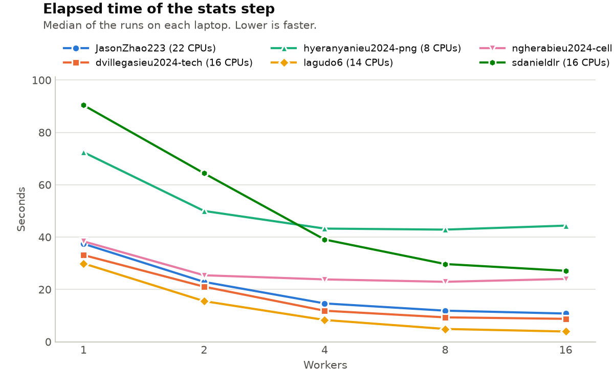

# Lab 1: The Nightly Report

## Warm-up: Generating the report

- What happened, and why: Git recorded `run_report.sh` as `100644`, without the executable bit. It still ran in our Windows-mounted Docker folder, but the executable bit was not recorded for other machines. `bash run_report.sh` worked because Bash reads the script directly.
- Fix and how it reached the team: We used `git update-index --chmod=+x run_report.sh` to record mode `100755`, then committed and pushed the change. The rest of the team received it with `git pull`.

## Task 1: Generating the report… again

- Symptom: `report.py` was killed when processing all 8.4 million orders.
- Commands and recordings used, why, and what they showed: We used `/usr/bin/time -f "$T"` for time and peak memory, `echo $?` for the exit status, and `cat /sys/fs/cgroup/memory.events` to check whether the container had run out of memory. The exit status was `137`, and `oom_kill` increased from 1 to 2. We also ran `python3 steps/report.py | tee /tmp/report.log` to capture the message before the crash. The log was empty; Python had buffered its output before the process was killed.
- Cause: The full DataFrame was about 887 MiB. Additional DataFrames created during processing pushed memory use beyond the container's 2 GiB limit.
- Fix: We changed `report.py` to process 100,000 rows at a time and accumulate revenue totals instead of keeping the full dataset in memory.
- Before and after (measurements): The old version reached 1,570,212 KB at 4 million rows and was killed on the full file. The chunked version completed all 8.4 million orders in 28.12 s elapsed (24.81 s user, 3.66 s system), with 203,812 KB peak memory. `tools/check.py` passed.

## Task 2: Extracting data

- Symptom: `extracts.sh` printed `extracts: done`, but all six regional CSV files were empty.
- Commands and recordings used, why, and what they showed: We checked the empty outputs with `ls -l`, then used `echo ${PIPESTATUS[@]}` to find the failed stage of the `grep | cut | wc -l` pipeline. The statuses were `2 0 0`: `grep` failed, while the following commands returned 0.
- Cause: After changing into the extracts directory, `../data/sales_2025.csv` pointed to a nonexistent file. `2>/dev/null` hid the error, and without `pipefail` the pipeline still appeared successful.
- Fix: We used the `DATA` variable for the input path, removed the error suppression, and added `set -euo pipefail`.
- Before and after (measurements): The broken run took 0.17 s and produced empty files. The corrected run took 8.70 s elapsed, with 8,064 KB peak memory. All six extracts passed `tools/check.py`.

## Task 3: Auditing

- Symptom: `audit.py` took 252.64 s on the full dataset.
- Commands and recordings used, why, and what they showed: We used `/usr/bin/time` to compare user and system CPU time, then `strace -c -e trace=openat,write,close` to count system calls rather than inspect individual calls. On 100,000 orders, `strace` showed 100,691 `openat`, 100,001 `write`, and 100,677 `close` calls.
- Cause: The file was opened, written to, and closed inside the order loop. The sample produced almost one `write` per order instead of using buffered writes across rows.
- Fix: We opened the output file once, before the loop, and closed it after all rows had been written.
- Before and after (measurements): The full run fell from 252.64 s to 49.04 s elapsed; system time fell from 82.12 s to 2.53 s. On the sample, the three tracked system calls dropped from 301,369 to 1,385. The output passed `tools/check.py`.

## Task 4: Segmenting the orders

- Symptom: The original `segments.py` took 3.42 s elapsed on 100,000 orders, including 3.26 s of user CPU time.
- Commands and recordings used, why, and what they showed: We used `/usr/bin/time` for the baseline and `python3 -m cProfile -s tottime steps/segments.py` to identify repeated Python function calls. The profile recorded 100,000 calls to `segment()` and 100,000 to `datetime.strptime`.
- Cause: Each order was classified and its date parsed separately in Python.
- Fix: Harutyun first replaced the row-by-row work with Pandas/NumPy operations in 100,000-row chunks. A later team change grouped each chunk by region, quarter, and numeric size category, summed the grouped counts across chunks, and arranged the final columns.
- Before and after (measurements): The first change reduced sample time from 3.42 s to 2.09 s, and the full run took 23.21 s. The latest team version completed all 8.4 million orders in 19.49 s elapsed (17.55 s user), with 165,364 KB peak memory. `segments.csv` passed `tools/check.py`.

## Task 5: Computing the statistics

- Symptom: `stats.sh` started 16 workers by default, although four were faster on the sample. Ctrl+C could also leave background workers running.
- Commands and recordings used, why, and what they showed: We used `/usr/bin/time` to compare worker counts with `WORKERS=N bash steps/stats.sh`: four took 1.39 s and 16 took 2.18 s on the sample. We used `ps -eo pid,ppid,stat,args` to check which worker processes belonged to the script and whether they remained after Ctrl+C. In one test, worker PID 2172 had parent PID 2160; after the final Ctrl+C test, no matching `stats_worker.py` processes remained.
- Cause: Starting 16 workers slowed the sample run, although the timing alone does not identify the bottleneck. The original script also did not reliably clean up background processes.
- Fix: We set the default to `min(nproc, 4)`, kept the `WORKERS` override, and added child-PID tracking and cleanup traps.
- Before and after (measurements): The fixed default took 1.37 s on the sample. The full run took 34.28 s elapsed, with 1,006,452 KB peak memory. The Ctrl+C check succeeded, and `stats.csv` passed the 72-group validation.

## The worker experiment

Each member ran `tools/sweep.sh` with 1, 2, 4, 8, and 16 workers, three times per setting. We plotted the medians using `python3 tools/plot_sweep.py`.

- How does the elapsed time change with the number of workers on each laptop? Jason, David, Leyre, and Sergio recorded their lowest medians at 16 workers (10.38 s, 8.76 s, 3.92 s, and 27.12 s). Nadia was fastest at eight (22.91 s, compared with 24.01 s at 16). Harutyun's Surface Laptop was almost unchanged between four and eight (43.25 s and 42.85 s) and slowed to 44.38 s at 16. We did not test more than 16 workers.
- Why do the curves differ? Harutyun's Surface has 4 cores/8 threads, and moving from four to eight workers saved only 0.40 s in the median. Nadia's 10-core/12-thread laptop slowed at 16, while Sergio's 8-core/16-thread laptop continued improving up to 16. Leyre (14 cores/14 threads), Jason (16 cores/22 threads), and David (16 cores/16 threads) also improved through 16. Sergio's extra logical threads may have helped, but we cannot establish that from these timings alone. Harutyun's Surface gained almost nothing beyond four workers.
- Which default worker count did we choose, and why? We chose `min(nproc, 4)` because the sample took 1.39 s with four workers versus 2.18 s with 16. This is a conservative default rather than the fastest setting for every laptop, so the `WORKERS` override remains available.

## Use of generative AI

We used ChatGPT (OpenAI) to discuss debugging results, suggest code optimizations, and draft or edit the explanations in this report using our own measurements. The main discussions covered chunked CSV reading, pipeline failures, file-opening costs, Pandas/NumPy vectorization, and process cleanup. All timings and output checks reported above came from the team's runs.

Examples of original prompts used to check technical concepts (quoted verbatim):

- Signals and worker cleanup:
  > "i didnt get what sigint and sigterm had to do with all of these"
- Git permissions and script execution:
  > "then why do we need to add the x then if it runs on bash and are we the owners of the project or anybody can just chmod the file?"

Examples of ChatGPT-generated text retained verbatim in the report:

> "The broken run took 0.17 s and produced empty files. The corrected run took 8.70 s elapsed, with 8,064 KB peak memory."

> "We opened the output file once, before the loop, and closed it after all rows had been written."

We checked the adopted suggestions with `/usr/bin/time`, `strace`, process checks, and `tools/check.py`. The results and measurements above came from our own tests.